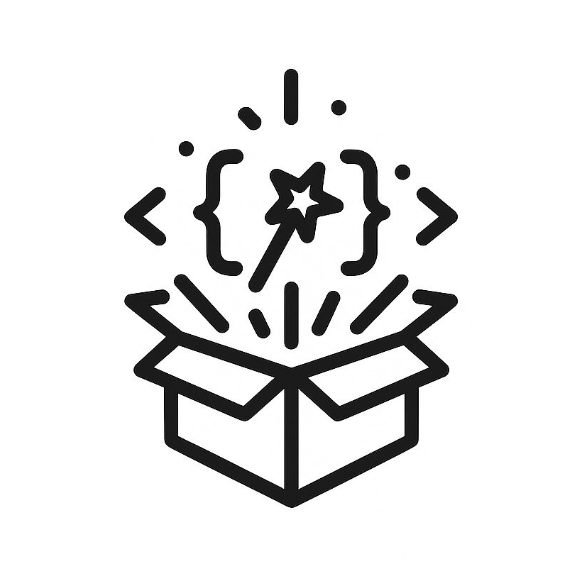

<p align="center">
  
</p>
<h1 align="center">VibeGen</h1>

<p align="center">
  <a href="https://github.com/vibe-engineers/vibegen-ts/actions/workflows/ci.yml"></a>
  <a href="https://www.npmjs.com/package/@vibe-engineers/vibegen"></a>
  <a href="https://github.com/vibe-engineers/vibegen-ts/blob/main/package.json"></a>
  <a href="https://github.com/vibe-engineers/vibegen-ts/blob/main/LICENSE"></a>
  <a href="https://www.npmjs.com/package/@vibe-engineers/vibegen"></a>
</p>

## Table of Contents

- [Introduction](#introduction)
- [Using WebLLM in a browser](#using-webllm-in-a-browser)
- [Features](#features)
- [Technologies](#technologies)
- [Team](#team)
- [Contributing](#contributing)
- [Others](#others)

### Introduction

**VibeGen** is a lightweight TypeScript package that lets you describe a function in natural language and ask an LLM for its return value. Wrap a function, describe what it should do, and call it with the usual arguments. An OpenAI or Google Gemini client on Node, or a WebLLM engine in the browser, generates the result from the signature, docstring, and arguments. The function body is skipped.

This example asks Gemini for the antonym of a word. Set `GEMINI_API_KEY` to run it.

```ts
import { GoogleGenAI } from "@google/genai"
import { VibeGen } from "@vibe-engineers/vibegen"

const apiKey = process.env.GEMINI_API_KEY
if (!apiKey) throw new Error("Set GEMINI_API_KEY to run this example.")
const client = new GoogleGenAI({ apiKey })
const vg = VibeGen(client, "gemini-3.1-flash-lite")

const getAntonym = vg({
  signature: "getAntonym(word: string): string",
  docstring: "Return the antonym of the given word. For example, the antonym of 'hot' is 'cold'.",
})(function getAntonym(_word: string) {})

const word = process.argv[2] ?? "hot"
const antonym = await getAntonym(word)
console.log(`The antonym of ${word} is ${antonym}.`)
```

Text is the default return type. For other results, pass a runtime `return_type` such as `Boolean`, `BigInt`, or a schema with a synchronous `parse` method. TypeScript erases type annotations during compilation, so VibeGen accepts the function's signature and docstring as options.

Install VibeGen and the SDK for your provider.

```sh
# Google Gemini
npm install @vibe-engineers/vibegen "@google/genai@^3.6.1"

# OpenAI
npm install @vibe-engineers/vibegen "openai@^7.62.0"
```

For setup from source, live examples, and class method decorators, see the [Developer Guide](docs/DeveloperGuide.md).

### Using WebLLM in a browser

VibeGen 0.1.1 accepts an initialized WebLLM engine. Install WebLLM alongside VibeGen in your browser application.

```sh
npm install "@vibe-engineers/vibegen@^0.1.1" "@mlc-ai/web-llm@^0.2.89"
```

On a WebGPU-capable device, WebLLM downloads the model on first use. Initialize it once on HTTPS or localhost and reuse the engine for subsequent calls. This example generates a value locally without an API key.

```ts
import { CreateMLCEngine } from "@mlc-ai/web-llm"
import { VibeGen } from "@vibe-engineers/vibegen"

const model = "Llama-3.2-1B-Instruct-q4f16_1-MLC"
const engine = await CreateMLCEngine(model, undefined, { temperature: 0 })
const vg = VibeGen(engine, model, { timeout: 30_000 })
const double = vg(function double(_value: number) {}, {
  signature: "double(value: number) -> number",
  docstring: "Return the input multiplied by two.",
  return_type: Number,
})

console.log(await double(7))
```

VibeGen uses the engine's sampling settings. The example sets `temperature: 0` for more consistent results. For structured output, WebLLM can constrain generation to a JSON object or array. Use a synchronous `parse` method when your function requires particular fields or values.

For inference in a Web Worker, pass the engine returned by `CreateWebWorkerMLCEngine` to the same factory. The application owns the model download and the engine lifetime. [WebLLM worker setup](https://github.com/mlc-ai/web-llm#dedicated-web-worker) · [Developer Guide](docs/DeveloperGuide.md#browser-inference)

### Features

- **Function mocking.** Call a function stub and await a generated result.
- **Natural language implementation.** Describe the intended behavior with a docstring. Include a full signature to give the model parameter names and types.
- **Multi-provider support.** Use the same wrapper with OpenAI, Google Gemini, or an initialized WebLLM engine.
- **Type enforcement.** Use built-in return types for simple values or supply a synchronous parser for structured output. [Return types](docs/DeveloperGuide.md#return-types)

### Technologies

##### Done with

<p align="center">
  
</p>
<p align="center">TypeScript on Node.js 22.13 or later and WebGPU-capable browsers</p>

##### Project Repository

[vibe-engineers/vibegen-ts](https://github.com/vibe-engineers/vibegen-ts) · [Python implementation](https://github.com/vibe-engineers/vibegen)

### Team

- [Kong Le-Yi](https://github.com/konglyyy)
- [Tan Jin](https://github.com/tjtanjin)

### Contributing

To contribute to VibeGen, fork the repository and open a pull request describing the change and how you tested it. The repository includes issue and pull request templates. [Developer Guide](docs/DeveloperGuide.md) · [Contributing](CONTRIBUTING.md)

For bugs or suggestions, open an issue or discuss it with the team on Discord. [GitHub issues](https://github.com/vibe-engineers/vibegen-ts/issues) · [Community Discord](https://discord.gg/dBW35GBCPZ)

### Others

For implementation questions, reach the team on Discord. To report a vulnerability privately, follow the security policy. [Community Discord](https://discord.gg/dBW35GBCPZ) · [Security policy](SECURITY.md)
